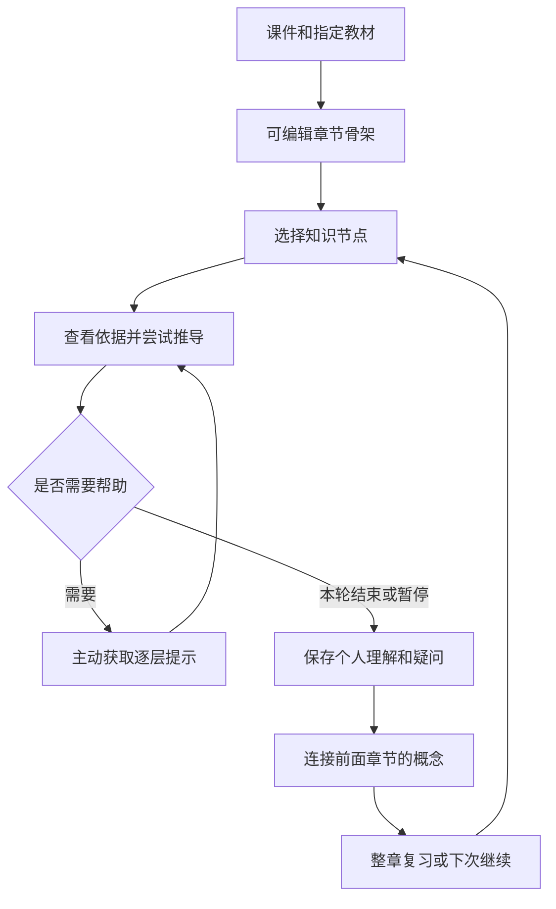

# 猫思之 V4 软件需求完善稿

编制日期：2026-10-19（Asia/Shanghai）。产品：猫思之 CatThinking。版本：4.0 需求基线候选。用途：供项目负责人编制最终软件需求规格说明书，不是软件实现完成报告。

本文沿用用户提供《软件需求规格说明书 [模版].docx》的九章结构。原模板文件编号 QMS—PROC－RD02 仅作模板来源记录，不自动作为本项目正式受控编号。正式编号、编制人员、审核签名由项目实际管理信息填写。

**V4 以知识节点组织学习：课件给出章节骨架，指定教材提供可核对依据，逐层提示帮助继续推导，个人理解与跨章节联系形成可持续复习的知识框架。** 首版在电脑完成；用户自行配置模型，为工具订阅付费。当前工作不以真人招募、付费验证或竞赛材料完成为前置条件。

## 修改历史

| 版本 | 来源及处理 |
| --- | --- |
| 原模板 1.0 | 保留模板结构，不继承示例系统需求和审批结果 |
| 项目 V3 | 继承导入、原文、学习记录、归档、备份、模型配置及可靠性要求；重新排序本机模型、甘特和趣味层 |
| V4 本稿 | 根据多轮定位讨论增加节点工作区、推导状态、跨章节语义关系、章节复习视图和工具订阅要求；尚未实施的项目明确标识 |

## 1 引言

### 1.1 目的

把“平时学懂一章，复习时找回整章思路，并搭建知识框架”转化为可实现、可测试的系统行为。读者应能据此判断首版必须提供什么、现有模块怎样复用、失败时如何保留资料，以及哪些能力暂不承诺。

### 1.2 背景

需求来自用户学习高级密码学和密码分析的实际经历：课件省略前置知识，AI 解释的深度与广度不贴合任务，聊天内容难以重新定位，个人推导和概念联系难以沉淀。用户明确希望保留独立推导和判断解释对错的能力，接受先尝试再获得逐层提示。

用户关于 IBE 的案例中，已提供完整 PPT、截图并明确询问 BB 与 BF 的区别。因此不能把该次不满意归因为用户未说明方案，也不能在未取得原始问答时确定模型故障根因。该案例用于提出方案身份、引用、比较维度与不确定性处理要求，不用作密码学结论的权威来源。

### 1.3 术语

| 术语 | 本稿含义 |
| --- | --- |
| 章节骨架 | 由课件结构形成、可修改的章节与知识节点层级，属于组织结构 |
| 知识节点 | 有稳定身份的学习对象，可关联多个资料片段、个人理解、推导和关系 |
| 前置关系 | A 是理解或推导 B 所需的前提，方向为 A 指向 B；不同于章节父子关系 |
| 推导轮次 | 用户围绕一次明确问题的尝试、提示查看和修订过程；可不关联题库题目 |
| 原文依据 | 带来源版本及定位信息的教材或课件片段；存在引用不等于推理正确 |
| 个人理解 | 用户自己编写或确认整理的内容；不能自动成为教材证据 |
| 提示层级 | 逐步增加明确程度的帮助；只在用户操作后推进 |
| 辅助记录 | 本应用观察到的提示、原文查看或完整解释暴露，不声称覆盖应用外行为 |
| BYOK | 用户配置自己的模型服务与凭据，模型费用由服务商按其规则收取 |
| 工具订阅 | 对软件的持续学习组织和辅助流程收费，与模型费用区分 |

### 1.4 预期读者与阅读建议

项目负责人重点读第 2、7、8 章确定范围；开发人员重点读第 3、5、6 章落实行为与数据；测试人员使用第 4、8、9 章建立验收；最终文档编制者结合[证据对照报告](./现状证据与历史需求对照.md)避免将历史结果混入 V4 状态。

### 1.5 参考资料

内部依据为本次定位对话、[README](../../README.md)、[V3 需求](../v3/软件需求规格说明书_V3.md)、[V2.2 分层提示](../LEARNING_SUPPORT_V2_2_SPEC.md)、V3 开发与审计、移动云接入、2026-10-18 优化计划及 2026-10-19 实施报告。完整来源、证据等级及冲突处理见[证据对照报告](./现状证据与历史需求对照.md)。竞品来源与推论仅在[竞争力方案](./竞品分析与竞争力方案.md)集中论证。

### 1.6 需求描述约定

需求编号 CT4 加领域和序号，编号固定不随章节排序变化。P0 表示会影响数据、安全或可信行为的发布阻断项；P1 表示 V4 核心产品能力；P2 表示可以后续扩展。商业发布的订阅门槛单独标注，不等于内部功能版必须先接入支付。

“已确认方向”来自用户明确选择；“建议”是本轮为完整性补充的设计；“已有基础”仅指在报告或源码中找到对应结构。本文所有验收条目均是未来目标，未标记本轮通过。真实用户数量、收入和提分指标不作为本文验收前提。

## 2 项目概述

### 2.1 系统功能

| 层次 | V4 内容 | 范围性质 |
| --- | --- | --- |
| 核心 | 课件骨架、节点资料、逐层提示、个人推导、跨章节联系、整章复习 | 首版必须形成连续流程 |
| 基础保障 | 来源定位、草稿保存、模型设置、任务恢复、课程包、原有练习兼容 | 伴随核心交付，不作为额外装饰 |
| 商业交付 | 工具权益、到期行为、订阅状态和费用边界 | 对外收费版本必须完成 |
| 后续 | 平板协同、云同步、完整手写识别、自动关系推荐、深入自动批改 | 不阻塞电脑首版，不暗示已支持 |
| 继承工具 | 现有题库、备考、应用任务、甘特、导出与伊希斯 | 保留数据与可达入口，服从节点学习主线 |

### 2.2 业务描述

用户建立课程并导入课件，可同时添加指定教材。先得到可修改的章节骨架；未配置模型时可以手工建节点继续学习。用户进入一个知识节点，查看当前问题、来源和前置概念，输入自己已推到的步骤。卡住时主动请求提示，仍卡住则逐层增加帮助。学完后把关键理由和未解决问题保存到节点，关联前面章节的概念。下次从原节点继续，或从整章视图找回整体思路。

### 2.3 数据流程描述

原文件经提取与用户预览成为版本化来源；节点引用来源片段，用户尝试单独存储。每次 AI 请求仅使用已选节点、当前问题、必要片段及本轮推导，显示发送范围。模型输出先作为提示或候选整理，不直接覆盖个人理解。用户确认保存后，形成学习记录及可导航关系；课程包携带必要来源与关联身份。

提示生成、内容采纳、个人理解保存是三个不同事件。查看结果、浏览大纲、切换节点、复习和恢复课程包不得隐式创建付费生成。

### 2.4 用户特点

首批场景是前置知识密集、需要理解原理和推导的大学专业课，以用户当前密码学课程作为设计样例。首批同学据用户反馈会配置模型，不能外推所有潜在用户都会配置。系统仍提供伊希斯配置教程与明确失败说明。

用户主要使用电脑，平板手写暂保留在外部流程；手工输入关键步骤可接受，不承诺识别完整手写证明。节点学习不能强迫每次都填写大量结构化表单。

### 2.5 运行环境要求

当前完整启动入口面向 Windows；已有 React、TypeScript、浏览器 IndexedDB、本机 Node 后台和 PostgreSQL 架构可复用。现有启动说明要求 Node.js 24 系列，具体支持环境以项目发布时清单为准。V4 不因本报告引入新的框架迁移。

首版目标验收视口建议为 1366×768 与 1920×1080，并覆盖 200% 缩放。窄窗口要求内容可达，但不等于承诺手机或平板产品交付。正常使用时退出再打开应回到固定应用来源，避免端口变化使浏览器资料看似丢失。

### 2.6 设计和实现限制

1. 每周约 24 小时的个人投入为规划背景，不将 AI 工具数量视为多个全职开发者。
2. 沿用现有生成预算边界：每次输出不超过 4096 词元、每任务不超过 24 次调用、输入不超过 10 万字符；修复与重试计入预算。节点辅导默认片段预算沿用 24000 字符，不能当作模型 token 预算。
3. 来源校验不因提速放宽。引用不存在、版本失效、结构损坏必须暴露，不由模型猜造填补。
4. 用户信息、密钥和课程内容不写入普通日志或订阅服务器。联网模型调用发送哪些内容必须可见。
5. 历史报告中的“题目优先”和“导图非主路径”由本次节点定位调整；历史数据兼容、安全和失败事实保留。
6. 原有安装包、离线模型验收缺口仍如实记录，但本机模型下载与完全离线生成不再是 V4 主路径前置。

## 3 功能需求的描述

本章各需求默认适用单人电脑使用。资料编辑属于本地用户操作；AI 生成另受模型配置、任务预算和商业版本权益控制。

### 3.1 CT4-SRC-01 课程资料导入和角色 P1

**输入与输出：** 接收既有支持的 TXT、Markdown、DOCX、PPTX、文字型 PDF，输出有课程归属、来源类型和版本的资料。保留当前单文件 25 MB、提取文本 200 万字符边界；导入容量不等于可整篇发送模型。

**规则：** 资料标记为课件、教材、笔记或课程大纲；章节范围可调整。提取后先预览，显示缺少可用文字、公式可能丢失或图片未识别等真实警告。扫描 PDF、图片型公式与演讲者备注不伪装成已完整读取。允许关联局部截图作为人工回看附件；图片发送模型须有明确能力和用户操作，首版不要求自动识别。

**异常与验收：** 空文件、坏包、超限、取消不得创建半份课程。使用含上下标、符号和图片公式的课件验证预览边界；提取无法表达时可继续阅读附件、手工补充或缩小范围，不得给“完整解析成功”的假状态。

### 3.2 CT4-SRC-02 可定位和可区分的依据 P0

**输入与输出：** 节点、来源片段与来源版本，输出可打开的原文位置，以及“课件依据”“教材依据”“个人理解”“模型推断”的内容类别。

**规则：** 定位保存来源 ID、归档或快照 ID、内容哈希、字符范围及可用页码或幻灯片编号。格式不提供页码时显示章节或段落，不造页码。教材提供补充解释，不默认为压倒课件的唯一真相；同名概念、符号与假设冲突并列提示，用户选择当前采用版本。

**异常与验收：** 来源更新后旧提示仍引用旧快照，新请求使用用户确认的新版本。失效定位显示原因且保留历史内容。对不存在引用、同名不同方案、教材与课件符号冲突、来源更新四类样例逐项验收，不能仅验证链接能打开。

### 3.3 CT4-MAP-01 可编辑章节骨架 P1

**输入与输出：** 用户选定课件范围，输出章节层级和候选知识节点。AI 生成骨架按明确操作发起；允许手工建立或修改骨架。

**规则：** 默认优先课件内内容，新增前置概念标注补充身份与依据。用户可增删、移动、改名、补充；导图与大纲作为同一知识对象的不同视图。重新生成只给差异候选，不能重置用户布局、推导、关系或已编辑标题。

**异常与验收：** 部分生成失败保留有效候选但标明范围；不能声称完成全章。验收包含手工节点与生成节点混合、改名后重新生成、删除后撤销、无 AI 创建和保存。

### 3.4 CT4-MAP-02 稳定身份和图谱一致性 P0

**规则：** 课程知识节点使用稳定 pointId，图形节点通过 binding 映射；标题、章节名称和屏幕坐标均不能代替身份。同名节点不自动合并；合并需要对照定义和来源，事务更新关系、推导引用和视图映射，并可撤销。

**输出与异常：** 更名或移动章节不破坏引用；移除画布展示不等于删除知识实体。归档节点保留历史，真正删除有影响范围预览。双窗口版本冲突保留本地草稿并允许比较或复制，禁止最后写入静默覆盖。

**验收：** 同名不同章、节点移动、已被其他页面修改、合并后再编辑与撤销、删除有入边节点均有一致结果；图形和列表打开同一节点时得到同一学习内容。

### 3.5 CT4-NODE-01 节点学习工作区 P1

**输入与输出：** 选中节点后进入该节点的资料、尝试、提示和个人理解工作区。没有题库也必须可学习。

**规则：** 首要操作是继续当前学习或开始尝试。资料按需展开，完整阅读可独立打开并返回原位置；节点切换前明确草稿保存状态。显示当前课程、章节、节点和本轮问题，避免同一个窗口回答错对象。提供前置概念、相关章节的往返导航，返回时保持原问题、输入和光标附近位置。

**验收：** 无题节点完成“读资料—写理解—保存—重开”；A 节点卡住去 B 补前提后回 A，草稿和提示仍归 A。本轮学习不被强制跳转到考试或新生成任务。

### 3.6 CT4-CTX-01 解释范围和前置缺口 P1

**输入：** 当前节点、学习目标、已有步骤、用户勾选的来源，以及已确认的前置关系。

**规则：** 默认范围为当前课件节点与选定教材段落。提示说明当前要解决的一步；需要其他前提时先指出缺口及其作用，由用户选择补学或继续。跨章节关系可供选择上下文，但不意味着每次发送整张图或整本教材。选择预算满时说明哪些内容未发送，不静默截断后称完整覆盖。

**输出与验收：** 展示简洁的本次范围摘要及可展开的发送清单。检验“只讲当前方案”“请求比较两方案”“教材未包含所需前提”“额外资料超预算”等场景。未绑定有效来源的补充默认标为模型推断，不能虚构教科书出处；绑定有效来源也不代表系统已证明原文支持该推理，语义正确性另按内容基准核对。

### 3.7 CT4-HINT-01 逐层提示和主动推导 P1

**输入：** 当前节点、本轮问题及可选的已有推导。允许用户表示不知道从哪里开始，不强迫编造尝试。

**建议首版采用既有三级语义：** 一级指出有关概念或前提；二级给下一步操作、局部推理或检查问题；三级在用户明确请求后提供完整解释，并给一个短的自主重述或重推入口。三级显示完整解释前标明会揭示完整思路；不自动推进、不以等待时长升级。

**规则：** 第一、二级尽量不暴露最终结论和完整证明。由用户选择更明确一层；第三层入口必须明确写“查看完整解释”，不能只写“下一层提示”。允许用户主动直接选择完整解释，不强制先消耗两次调用。准备未查看不计暴露。生成候选与已查看状态分开。模型返回越级答案时提供标记渠道，并按实际暴露记录，不能仍显示一级无答案帮助。

**异常与验收：** 拒答、超时或依据不足保留输入；同一层重试是显式新调用。固定样例检查每层内容边界和提示泄露，不能仅靠系统提示词包含“不要给答案”判定通过。独立重推以新的尝试记录，不改写原轮次。

### 3.8 CT4-HINT-02 推导轮次与辅助记录 P0

**规则：** 推导可脱离题库存在，绑定 courseId、pointId、roundId、问题、来源快照和修订号；已有题库尝试仍使用原 questionRef 与 attemptId，不制造假题来容纳自由推导。

每次提示生成、查看、完整解释查看和原文查看归属明确轮次。提交冻结本次文字及可观测辅助事实。新轮次不继承旧轮次的帮助次数；历史缺字段为未知，不补成零帮助。应用无法判断用户是否在平板或外部 AI 看过答案，因此表述为“本次未记录应用内提示”，不自动认证独立能力。

**验收：** 同一节点两个问题交错、两个窗口、提示生成后未打开、提交后再看答案、来源变化、旧包导入分别验证。保存失败不能宣称辅助已记录，必须保留输入和可见失败状态。

### 3.9 CT4-NOTE-01 个人理解与推导积累 P1

**输入与输出：** 用户自己的说明、关键步骤、仍有疑问的原因和可选公式，形成可编辑、可回看修订的节点内容。

**规则：** 首版允许自由文本加公式表达，不要求每次填完多栏。可选“关键理由”“推导步骤”“仍有疑问”快捷结构。AI 整理是候选，只有明确采纳才写入个人内容，并保留采纳来源；不能把全部聊天自动灌入笔记。手工文字不被重新生成覆盖。公式支持可编辑源码与渲染，渲染失败保留源码，不因上标、下标或负号丢失改变意义。

**验收：** 整理前后可对比、拒绝不写入、保存失败保留草稿、重开保留公式；标题变化或章节移动不影响内容。记录修订不直接提升学习能力分数。

### 3.10 CT4-LINK-01 跨章节语义联系 P1

**输入与输出：** 同一课程不同章节中的两个知识点、关系类型、用户说明及可选依据，输出可双向导航的关系。

**规则：** 首版必须支持手工连接跨章节节点，不可缩减为单章树形导图。最低支持前置、推导步骤、对比和应用；既有其他类型继续兼容。前置 A→B 表示 A 是 B 的前提，需防自环和循环；对比等非依赖关系允许形成网络，不套用前置关系的无环限制。

用户可以写“为什么有联系”，其性质为个人解释；可另附教材引用。AI 推荐关系属于候选，不直接加入确认图。显示目标章节与关系方向，提供返回原节点入口。首版跨章节限同一课程，跨课程关系留到后续处理包边界。

**异常与验收：** 重复关系、前置循环、同名不同点、目标被归档、撤销、课程包恢复均验证。导出图像不能替代关系数据备份。跨章节关系有三个以上节点的导航案例才算完成，不能只画一根不可点击的线。

### 3.11 CT4-CMP-01 方案身份与个人差异记录 P1

**首版范围：** 用户选择两个节点或来源片段，明确方案名称及当前材料中的版本，手写差异说明并关联对比关系。明确对象、保存个人差异和回查来源属于核心；不要求独立的复杂比较编辑器。

**新增增强建议 P2：** 提供“讨论对象、前提、关键步骤、结论或适用条件”的 AI 比较表候选，确认后写入个人内容。此项是本稿建议，不是用户已确认的首版必交付能力；可复用既有 compare 模式逐步实现。

**规则：** 已明确询问 A/B 时不得无理由反复要求用户说清对象。材料不足以辨认具体变体时，显示缺少的出处或定义。符号解释按来源和节点范围保存，避免跨章节同一字母混用。未知单元格写未找到依据，不用流畅文字填满表格。

**验收：** 以公开或自编合成的同名不同方案夹具测试身份不混淆、前提不串用、引用可回查、个人比较可保存。IBE 的真实技术内容需按实际指定教材建立答案基准，本稿不编造 BB/BF 的密码学差异。

### 3.12 CT4-REV-01 整章复习与思路恢复 P1

**输入与输出：** 章节骨架、个人理解、最近学习记录和已确认关系，输出可折叠的整章复习视图。

**规则：** 优先展示本人保存的关键理由、上次卡点与跨章节前提，不重新生成整章长文。可切换“看整体结构”“展开自己的推导”“只看未解决疑问”。返回关联章节后可回到原位置。提供先隐藏个人推导再尝试重写的选择，属于新的学习记录，不声称掌握率。

**验收：** 未配置模型、断网和订阅失效时仍能读已保存框架。记录一次卡点及前置联系，关闭重开后从整章视图找回并继续；整个过程不发生成请求。新增 AI 复习整理必须另行主动发起。

### 3.13 CT4-FLOW-01 续学和下一步一致性 P1

**规则：** 首页的标题、解释、按钮和实际目标使用同一决策对象。续学优先保留用户上次明确节点与轮次；用户选择复习优先时进入对应复习目标。目标不存在或来源失效则回到所属课程说明，不悄悄打开另一题。

暂停、继续、手动日期、已保存建议分开；程序关闭时不承诺后台系统提醒。旧练习和新节点轮次互不覆盖。课程空态可导入、手建节点或恢复包，不要求先有正式题库。

**验收：** 旧正式会话、新节点草稿、到期复习同时存在，以及删除目标、切换课程、刷新恢复等组合，按钮目标和保存对象始终一致。

### 3.14 CT4-AI-01 自配模型与能力检测 P1

**规则：** 复用模型设置与后台加密凭据存储，展示实际服务主机、模型及配置版本。目录可读、短问答成功、引用结构可用、节点提示质量分别标识，不把连通当质量通过。切换服务不搬用旧服务密钥；配置更改不影响已开始任务绑定的版本。

**输入与异常：** 用户填服务与密钥，查看连接或主动执行会消耗额度的短测试。鉴权失败、模型不存在、请求不支持、余额问题、响应未知分别说明；不在伊希斯聊天框收集密钥。无 AI 时本地资料、手工框架、笔记和备份保持可用。

**验收：** 至少对拟支持的服务分别建立能力记录；“兼容接口”不等于任意模型均可完成结构化学习任务。新服务扩展必须经过同一内容与失败测试。

### 3.15 CT4-AI-02 生成状态和预算可控 P0

**规则：** 请求状态至少区分准备、已发送、处理中、成功、部分成功、失败、结果未知和取消请求已提交。发送后断线不保证未计费；取消不保证服务商停止。刷新、查看历史、连接恢复和轮询失败不自动重新生成。

对同一输入和版本复用已准备记录或已完成结果时，显示复用信息；缓存键包含来源哈希、节点和个人输入修订、提示层级、模型配置及提示模板版本。新输入不能取用旧答案。复用的是内容，不是旧轮次辅助记录；本次查看重新记录到本轮身份。多层提示、格式修复和重试记录调用消耗；节点会话累计预算不得靠自动拆成新任务绕过既有硬上限。

迟到结果只能归入发送时绑定的 courseId、pointId、roundId 和输入修订。用户已换节点、改问题或开新轮次时，旧结果保留为历史可查，不覆盖当前输入，不显示成当前问题的最新提示。

**性能策略：** 当前节点只生成当前所需内容，不默认五类产物一起生成。进度展示真实阶段与已过去时间；监听断开时提示“状态暂时不可见”，不直接认定任务失败。查询指数退避、遵循 Retry-After、多页面避免重复高频查询。

**验收：** 模拟 429、SSE 中断、任务后台已成功而页面断线、超时、输出截断、未知用量、重复点击和取消后迟到响应。历史失败不得靠扩大预算或跳过语义校验变为成功。

### 3.16 CT4-GUIDE-01 伊希斯情境引导 P1

**规则：** 伊希斯说明真实下一步，包括配置模型、建立首个节点、请求提示、保存理解、连接旧章节和复习。配置教程应版本化、可在无模型时打开，并定位真实设置入口。预设教程和模型生成回答明确区分。

**交互：** 提示不抢输入焦点、不遮挡保存按钮、不使单选或公式输入重排失效；可安静显示、主动呼唤和关闭。用户选关闭不影响核心操作。

**验收：** 未配置模型时完整看教程；密钥只在设置输入；输入过程中气泡出现或消失不导致丢字、误点；关闭对话后焦点回原控件。故事和 RPG 扩展不作为 V4 完成门槛。

### 3.17 CT4-DATA-01 课程包和空环境恢复 P0

**范围：** 课程资料、来源快照、知识节点、跨章节关系及说明、个人笔记修订、推导轮次、提示查看记录和原有学习记录。API 密钥、可执行后台任务与支付凭据不进入课程包。

**规则：** 无课程时即可进入恢复预览，不要求先建空课。恢复到新课程，统一重映射节点、关系、轮次、来源和附件身份；取消、坏包或写入失败不留下半份课程。缺失附件或外部目标明确报告，不静默丢边。默认不覆盖已有课程或全局偏好。

**验收：** 导出跨章节样例，在空环境恢复后实际点击来源、关系目标、个人推导、历史轮次，不仅核对数量。下载触发成功不等于用户已安全保管文件；提供检查文件与恢复说明。

### 3.18 CT4-DATA-02 版本迁移和冲突保护 P0

**规则：** 当前学习实体 version:1 及包格式不得直接加必填字段后强制读取。新字段提供明确旧值语义，涉及新实体或关系说明的格式需版本化；迁移先校验、备份，再一次性提交。旧辅助记录缺失为未知，旧 confirmed 不升级为答案已经审核。

**异常与验收：** 升级失败原库可用；旧包导入可读；较新未知包阻止写入并解释；并发窗口修改通过 revision 比较提示冲突。回滚程序前先判断新数据兼容，不能只退代码后让旧程序破坏新字段。

### 3.19 CT4-SUB-01 工具订阅与资料所有权 P1

**已确认：** 工具订阅收费，模型由用户自行配置和付费。**建议规则：** 资料阅读、手工整理、历史查看、完整导出和恢复始终保留；订阅权益覆盖自动骨架、分层 AI 辅导流程、比较整理及后续自动辅助功能。功能版可先使用测试权益，正式收费版必须完成真实权益与支付状态核对。

订阅界面分别说明工具费用与第三方模型费用；不销售“无限模型额度”。到期停止新增受限自动任务，但保留已经获得内容和手工编辑。已发出的任务允许恢复查看结果，不能因权益到期永久隐藏用户已付模型费用的结果。建议任务授权绑定初次确认的范围和预算，到期后可在原授权预算内完成既定分块或格式修复；新增范围、人工重试和重新生成按当前权益重新判断，原预算不因到期放宽。结果查询本身不能触发新的生成调用。

**建议技术行为：** 许可证或账户权益只包含产品权限、有效期和最小设备信息，不上传课程正文或密钥。显示有效、即将到期、已到期、校验暂不可用；建议签名离线权益和明确宽限期，具体期限配置化，不在本稿虚构价格或付款规则。校验暂不可用与确实到期不能混为一谈。有可验证签名且在有效期或明示宽限期内时可发起受限任务；无有效证明且无法校验时不发起新的受限任务，仍保留阅读、手工编辑、恢复、导出和已发任务的恢复查询。

**验收：** 到期、短时离线、重复回调、退款或撤销、时间回拨、退出账户、更换设备分别验证。付费状态不能由前端布尔值决定；支付失败不显示成功。没有支付渠道实现时只能称功能预览，不称正式订阅发行。

### 3.20 CT4-LEG-01 既有学习功能兼容 P0

**规则：** 原有正式题目、备考、补学、应用任务、复习安排、甘特和导出仍可找到，旧记录不因首页改为节点主线删除。新增节点模式可以无题工作；正式模拟考仍遵守原有不泄露答案和依据的边界。

练习内容的资格在展示与提交层一致校验，争议题保留历史但停止不合格的新提交。新节点笔记不伪装成正式作答。旧题来源来自对应归档，不用新版教材替换旧依据。

**验收：** 旧课程恢复、已进行考试、争议题、旧复习日期、甘特任务、知识图编辑及导出均在新导航下可用；新模式不能让用户通过其他入口绕过原题资格。

## 4 非功能需求

### 4.1 CT4-PERF-01 性能和容错 P1

以下为建议验收目标，不是现有性能实测：在记录 CPU、内存、浏览器和构建版本的参考 Windows 电脑上，使用 20 章、500 节点、1000 条关系、100 份笔记的固定夹具，节点切换 P95 不超过 500 ms、本地保存可见确认 P95 不超过 1 s、章节总览冷打开不超过 3 s。数据先预热与冷启动分别记录；至少 30 次操作报告 P50/P95 和失败次数，不混入模型时间。

AI 请求发起后 1 s 内显示本地任务状态；服务商输出时间单独测量，不承诺固定秒数完成。长公式横向滚动、长答案纵向展开；大图局部渲染或折叠，但检索仍覆盖全课程。保存失败、后台退出、浏览器刷新均要保留最近已确认保存版本，未保存输入有可复制退路。

历史 1050 节点画布测试不能直接证明新语义网络性能；历史 51 s 的生成场景不能当作所有模型的时延指标。性能优化须保持引用完整性及原预算。

### 4.2 CT4-SEC-01 安全和保密 P0

凭据只进入既有安全后台配置存储，不进入浏览器持久化、课程包、截图报告或日志；诊断输出做脱敏。导入内容和模型回答作为不可信文本，不能要求系统更换服务商、泄露密钥或执行文档内指令。外部链接和富文本过滤可执行内容。

用户每次生成能检查选定范围与服务主机；默认不读取其他课程、整本教材或未选中的个人笔记。订阅服务与学习资料保持数据边界。资料删除、日志清理和课程包加密分别有明示操作，不以删除课程顺带删除本机模型或其他项目文件。

### 4.3 备份与恢复要求

CT4-DATA-01 与 CT4-DATA-02 是核心要求。建议个人学习内容不自动到期清除；可清除的缓存不得包含唯一来源或唯一推导记录。生成候选缓存过期与个人采纳内容永久保存分离。恢复前验证格式和引用闭合，恢复后执行导航抽查。建立课程包格式升级说明，保留至少一套旧版夹具用于兼容回归。

### 4.4 CT4-LOG-01 日志和可追踪性 P1

建议默认诊断日志滚动保留 14 天，可由用户清理；学习内容与历史不受此期限影响。记录应用版本、任务 ID、模型配置版本、耗时、阶段、错误码、确认用量及未知用量标记；不记录完整提示、教材正文或用户密钥。诊断导出前可预览。

产品验收记录需包含实际执行日期、构建指纹、样例来源、测试范围、通过失败与跳过，不把同一测试子集重复相加。取消、重试、模型切换与缓存命中可追踪，但不以日志完整性冒充学习效果。

### 4.5 CT4-UX-01 可达性和内容完整性 P1

树形与关系图提供列表、搜索和键盘替代操作。默认先看当前章节和一层相关节点，按需展开，避免将整门课所有边同时堆在屏幕。点击目标建议至少 44×44 CSS px，焦点可见；支持减少动态效果偏好。

1366×768、1920×1080、200% 缩放下所有保存、关闭、下一层提示与返回入口可达。不得只检查页面无横向溢出，还要实际访问长内容末尾、最后一列与弹窗底部。

## 5 外部接口说明

| 接口 | 输入输出及约束 |
| --- | --- |
| 文件导入 | 复用既有提取器；保留来源类型和定位信息；解析失败不能默默变空文档 |
| 浏览器与本机后台 | 同源网关和配置版本；生成幂等标识、查询任务、取消请求、获取结果分开；具体路由由现有 API 扩展评审决定 |
| 模型服务 | 接收受预算约束的片段与最小上下文；输出结构化提示、引用和不确定性；对模型能力逐项适配 |
| 本地存储 | 版本化实体、事务保存、revision 冲突保护；不在数据库事务内等待长网络调用 |
| 课程包 | 显式版本、来源与附件清单、关系端点映射、可选加密；不执行包内任务 |
| 订阅权益 | 最小授权标识、签名权益及到期信息；与模型密钥、课程正文隔离；正式支付回调幂等 |
| 可读导出 | 建议提供 Markdown 笔记和关系说明导出；完整恢复仍以课程包为准，图像不冒充可编辑备份 |

建议新增节点辅导请求契约至少包含 courseId、pointId、roundId、sourceRefs、sourceVersions、learnerInputRevision、hintLevel、providerConfigRevision、idempotencyKey。客户端不得发送后台密钥；服务器重查来源身份、参数和预算。响应至少包含 taskId、status、hintLevel、content、citations、unsupportedClaims 与 usageState。以上为逻辑字段建议，不声称当前路由或接口已经存在。

## 6 其他需求

### 6.1 数据模型完善建议

优先扩展现有课程领域，避免新建与现有图谱互不相认的第二套数据库。

| 对象 | 已有基础 | V4 增量建议 |
| --- | --- | --- |
| 课程与资料 | Course、CourseDocument 已有角色与章节字段 | 明确资料版本和课程内章节稳定 ID，旧章名保持兼容 |
| 知识节点 | KnowledgePoint 已有 notes、chapter、sourceRefs、docId/nodeId | 增加来源/个人内容区分与可恢复修订；不能改名就改变身份 |
| 图形绑定 | NodeBinding | 保持图形节点与知识节点映射，重新生成时展示差异 |
| 关系 | KnowledgeRelation 已有类型、端点、确认和来源 | 补充关系说明、来源性质和生命周期；前置与非依赖关系采用不同校验 |
| 推导轮次 | LearningSupport 有 pointIds、hintLevel、learnerAnswer 等；PracticeAttempt 依赖题目 | 增加可无题存在的轮次对象或等价扩展，不能强塞入 questionRef |
| 笔记修订 | 节点 notes 与学习旅程 note | 记录用户修订、AI 候选采纳及来源，提供历史恢复 |
| 复习快照 | 课程、节点、关系及学习历史 | 从已有数据派生结构视图；不复制成与原节点脱节的新全文 |
| 工具权益 | 本轮未确认现有实现 | 单独建立最小权益服务及离线状态，不能假定已有账户计费 |

章节树表达组织，前置关系表达依赖，个人联系表达理解，这三种结构不能混为同一组边。先复用现有同课程跨章关系，再设计跨课程导出闭包，首版不自动扩大到跨课程网络。

### 6.2 状态与失败处理

| 场景 | 显示及可执行动作 | 禁止行为 |
| --- | --- | --- |
| 有资料无题库 | 手建或查看节点、阅读和写理解 | 把学习入口锁在出题完成之后 |
| 公式提取不完整 | 原附件回看、手工修正、标明待核对 | 当作准确公式继续证明 |
| 依据不足 | 指出缺口，选择教材范围或暂停 | 伪造书页与引用 |
| 提示结果未知 | 恢复查询、复制输入、显式重新生成 | 自动再次付费请求 |
| 笔记保存冲突 | 显示两版、保留本地草稿 | 静默覆盖较新版本 |
| 前置关系成环 | 标出循环链，取消本次关系写入 | 删除既有边以便强行通过 |
| 订阅过期 | 保留数据、阅读、手工编辑和导出 | 扣留资料或清空课程 |
| 来源更新 | 旧记录可读，新生成需选新依据 | 把旧证明悄悄绑定新教材 |
| 关联目标归档 | 显示目标状态，允许查看历史或解除联系 | 跳到同名另一节点 |

### 6.3 内容质量和资料边界

教材原文、用户理解和模型推断分开标识；学习者点击确认只能证明他确认了关联或采纳，不能改写成教师认证。订阅产品不附带未经许可分发的教材内容。软件提供私人导入、关联和导出能力，不在本轮设计公开教材库或课程交易市场。

### 6.4 第一版体验样例

导入一份含方案 A/B 的课件和一段教材，建立两章知识点。用户在当前章方案 A 的关键步骤卡住，先输入现有思路，获得一级前提提示，转到前章概念核对，返回后获得二级局部提示并继续推导。用户把关键理由写入节点，用前置关系链接旧章概念；再保存 A/B 的差异说明。关闭软件重开，从整章结构中恢复这条思路。样例内容可自编，必须标注，不能借此声称解决了真实密码学全部难点。

## 7 需求变更识别

| 旧方向或可能变化 | V4 处理 | 不变条件 |
| --- | --- | --- |
| 首页题目优先 | 节点与章节为默认主线，旧练习独立可达 | 旧记录、题目资格和模拟考边界保留 |
| 本机模型打包与断网生成优先 | 作为后续可选部署，不阻塞 BYOK 主线 | 不把联网调用描述为离线 |
| 轻成长、故事和 RPG 同期 | 伊希斯实用引导优先，其他后移 | 已有偏好和内容不强制删除 |
| 导图只作辅助工具 | 章节骨架与节点成为学习组织入口 | 图形身份与学习身份必须一致 |
| 学习准备默认少量测验 | 节点路径默认骨架与依据，练习路径保留按需出题 | 不让两条路径互相重置参数 |
| 仅单章结构 | 同课程跨章节关系进入首版 | 前置循环校验、来源与恢复完整 |
| 模型或服务更换 | 使用能力检测和版本化适配 | 预算、引用、个人数据边界不放宽 |
| 订阅价格和权益调整 | 价格配置化，保留已购有效期与结果访问 | 个人内容可读、可编辑、可导出 |

价格、支付渠道、自动关系推荐算法和跨设备架构属于后续设计选择，不影响本稿定位。新要求改变数据契约或付费边界时更新需求版本与迁移计划，不能直接覆盖旧约定。原报告的竞赛时限不沿用为 V4 全部功能的承诺日期。

## 8 功能列表与追踪

### 8.1 需求追踪表

“基础”指可复用代码或报告证据，不表示 V4 验收通过。验收 A 编号见第 9 章。

| 需求编号 | 核心内容 | 优先级 | 现状判断 | 验收 |
| --- | --- | --- | --- | --- |
| CT4-SRC-01 | 资料角色与提取边界 | P1 | 有导入基础，需公式与角色流程完善 | A01 |
| CT4-SRC-02 | 来源定位和版本 | P0 | 有归档和引用基础，需节点范围贯通 | A02 |
| CT4-MAP-01 | 编辑章节骨架 | P1 | 有导图大纲，需节点主线和差异更新 | A03 |
| CT4-MAP-02 | 稳定身份与一致性 | P0 | 有绑定与版本基础，需增量契约 | A04 |
| CT4-NODE-01 | 无题节点工作区 | P1 | 有知识工作区，需调整主流程 | A05 |
| CT4-CTX-01 | 范围和前置缺口 | P1 | 有片段选择，需任务级范围控制 | A06 |
| CT4-HINT-01 | 逐层提示 | P1 | 有三级提示基础，需语义验收 | A07 |
| CT4-HINT-02 | 轮次辅助归属 | P0 | 有辅助记录，独立无题轮次需补齐 | A08 |
| CT4-NOTE-01 | 个人理解修订 | P1 | 有 notes，需采纳与修订体验 | A09 |
| CT4-LINK-01 | 跨章节关系 | P1 | 有图谱与前置校验，需说明及主界面贯通 | A10 |
| CT4-CMP-01 | 方案身份与个人差异 | P1 | 有 compare 模式，先补身份和手工差异；AI 表格为 P2 建议 | A11 |
| CT4-REV-01 | 整章思路恢复 | P1 | 需组合已有数据形成新视图 | A12 |
| CT4-FLOW-01 | 续学目标一致 | P1 | 有决策基础，需新旧路径统一 | A13 |
| CT4-AI-01 | BYOK 与能力检测 | P1 | 有设置基础，质量能力需分级 | A14 |
| CT4-AI-02 | 生命周期与预算 | P0 | 有任务管线，需节点缓存和累计约束 | A15 |
| CT4-GUIDE-01 | 伊希斯情境引导 | P1 | 有引导，需新流程教材 | A16 |
| CT4-DATA-01 | 完整课程包恢复 | P0 | 有课程包，需新增对象兼容 | A17 |
| CT4-DATA-02 | 迁移与冲突 | P0 | 有事务与修订，需新版迁移 | A18 |
| CT4-SUB-01 | 订阅及退出边界 | P1 | 本轮未发现足够实现证据，按新增设计 | A19 |
| CT4-LEG-01 | 原有功能兼容 | P0 | 有实现，需回归新入口 | A20 |
| CT4-PERF-01 | 性能和容错 | P1 | 历史性能证据不覆盖新图谱 | A21 |
| CT4-SEC-01 | 安全和保密 | P0 | 继承并扩展现有安全边界 | A22 |
| CT4-LOG-01 | 日志可追踪 | P1 | 有任务诊断，需轮次与权益状态 | A23 |
| CT4-UX-01 | 可达性和完整显示 | P1 | 继承布局修复，需新工作区验证 | A24 |

### 8.2 建议实施顺序

| 阶段 | 交付 | 退出条件 |
| --- | --- | --- |
| M0 数据与旧版兼容 | 来源、轮次、关系说明、修订、包迁移设计及固定夹具 | 身份不串、旧包可读、保存冲突可恢复 |
| M1 知识框架 | 章节骨架、节点资料、个人笔记、手工跨章关系 | 无模型也能完整组织并恢复两章内容 |
| M2 自主推导 | 范围控制、逐层提示、方案身份与手工差异、模型任务恢复 | 无题轮次可用，提示边界与来源检查通过 |
| M3 复习与体验 | 整章复习、节点续学、伊希斯教程、性能与布局 | 重开找回思路，无隐式调用和输入丢失 |
| M4 商业发行 | 订阅权益、支付核对、离线或到期行为、支持材料 | 真实收费链路与资料退出边界验收完成 |

M1 包含跨章节关系，不能把它移到“增强版”而仍称首版符合定位。M0 至 M3 可交付内部功能版；商业上线必须额外完成 M4。本稿不承诺固定工期或以真人数量阻断需求完善。

## 9 附件及验收要求

### 9.1 验收矩阵

以下全部为待执行标准，本次仅完成文档核查。测试层分别包括规则测试、真实存储的浏览器操作、合成模型故障测试及有明确额度边界的真实模型内容检查；不把任何一层替代另一层。

| 编号 | 验收任务 | 最低通过条件 |
| --- | --- | --- |
| A01 | 导入课件及教材，含图片公式与坏文件 | 角色和范围正确，缺失可见，无半数据 |
| A02 | 引用跳转、同名方案及来源更新 | 打开正确版本片段，未知不伪造 |
| A03 | 修改骨架后再次生成 | 仅预览差异，个人内容不被覆盖 |
| A04 | 同名、移动、合并撤销和双窗口 | 稳定 ID，关系一致，冲突保留草稿 |
| A05 | 无题节点读写并去前置节点返回 | 原轮次与输入完整，无强制出题 |
| A06 | 当前方案范围及超限上下文 | 范围可见，无静默扩展或截断冒充完整 |
| A07 | 分别查看三级提示及直接请求完整解释 | 一级二级不越级，三级按钮明确揭示，无强制额外调用 |
| A08 | A/B 轮次交错和提交后看解释 | 辅助不串、原答不改、未知保留 |
| A09 | 笔记修订、公式、AI 整理接受拒绝 | 个人内容保留且可回看，无静默采纳 |
| A10 | 跨章前置、比较、环和归档目标 | 前置防环，非依赖可成网，目标可达 |
| A11 | 两方案比较与相同字母不同含义 | 对象分明，差异有依据，缺项显示未知 |
| A12 | 无模型整章复习与重推 | 恢复本人思路，无自动生成 |
| A13 | 混合续学复习状态 | 显示对象与跳转一致，进度不覆盖 |
| A14 | 服务切换、短测试与不支持能力 | 配置清楚，密钥隔离，不将连通当质量通过 |
| A15 | 429、断线、取消、未知用量、重复点击与切换节点后的迟到结果 | 无自动付费重发，预算累计，结果归原轮次且不覆盖现稿 |
| A16 | 无模型教程和输入中气泡 | 教程可达，输入焦点和控件不失效 |
| A17 | 导出后空环境恢复并实际导航 | 来源、节点、关系、轮次全部对应，无密钥 |
| A18 | 旧包、新版未知包、升级失败 | 不丢原库、不写坏数据、不伪造旧辅助 |
| A19 | 到期、断网、回调重复与未完成任务 | 权益正确，历史与手工数据可用，结果可取回 |
| A20 | 旧练习、模拟考、甘特和备份 | 原数据与语义保留，入口没有绕过资格 |
| A21 | 固定规模性能和保存故障 | 按参考环境报告 P50/P95，达标或明确阻断 |
| A22 | 恶意导入、脚本内容和密钥导出检查 | 不执行来源指令，无凭据或额外课程泄露 |
| A23 | 诊断导出及日志清理 | 信息足以复现，正文和密钥不出现 |
| A24 | 两种桌面视口、200% 缩放、键盘 | 最后内容和所有操作可达，返回焦点正确 |

### 9.2 内容质量基准建议

建立 12 个固定任务，覆盖省略前提、同名异义、两方案比较、跨章前置、符号冲突和资料不足，每类至少两例。基准明确允许的来源、核心理由、不得提前揭示的结论及预期失败方式。内容可用自编合法材料，不依赖招募真实学生。

规则及来源完整性要求全通过；模型内容以逐例核对记录结论。未通过的模型或任务类型标记受限，不能用平均分掩盖关键概念错误。相同模型、相同材料和近似预算下比较“普通聊天流程”与“V4 节点流程”，记录找回依据所需操作、上下文重复输入量、无意答案暴露、保存理解及重开恢复是否成功。这里只验证功能与任务表现，不以一次重推推断长期学习能力提高。

### 9.3 最终规格编制附件

附上[现状与历史对照](./现状证据与历史需求对照.md)以及[竞争力方案](./竞品分析与竞争力方案.md)。正式实现后另附实际测试日志、版本指纹和遗留项，不把本稿的需求表复制成已通过清单。
